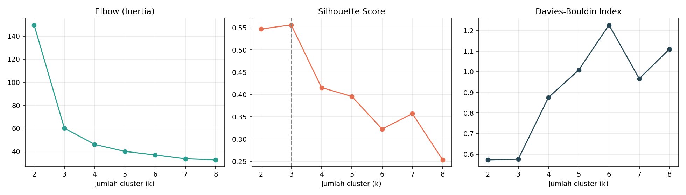
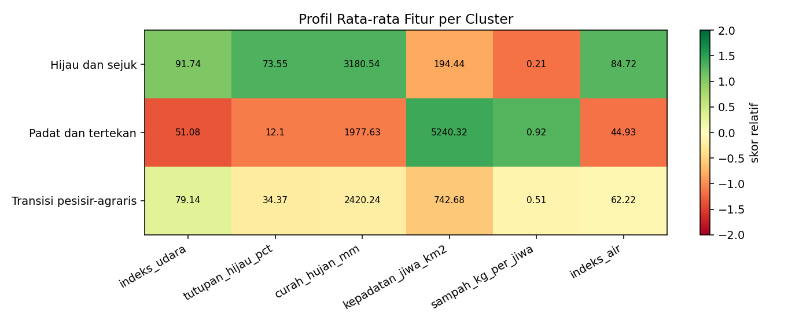
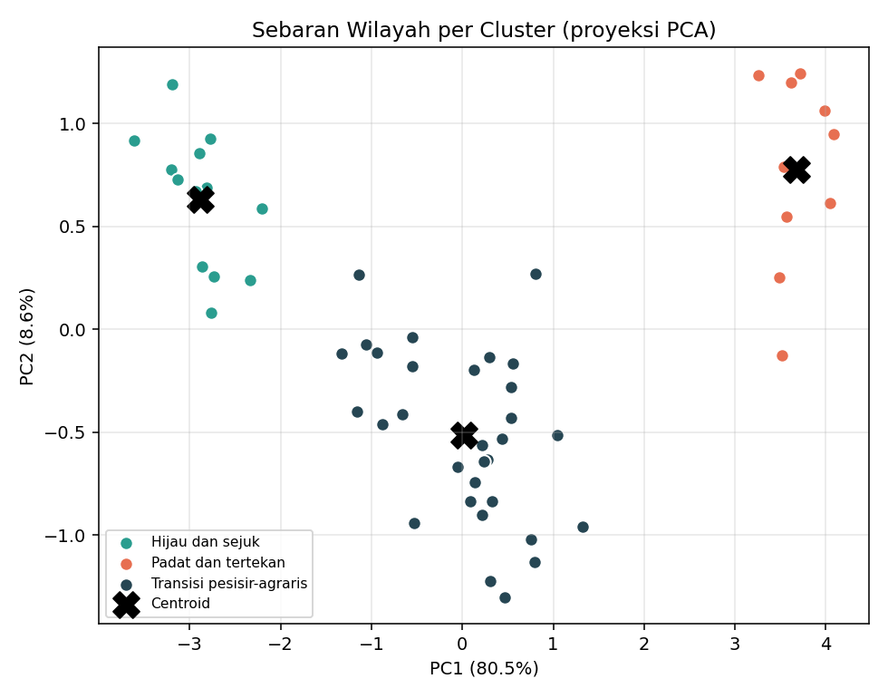
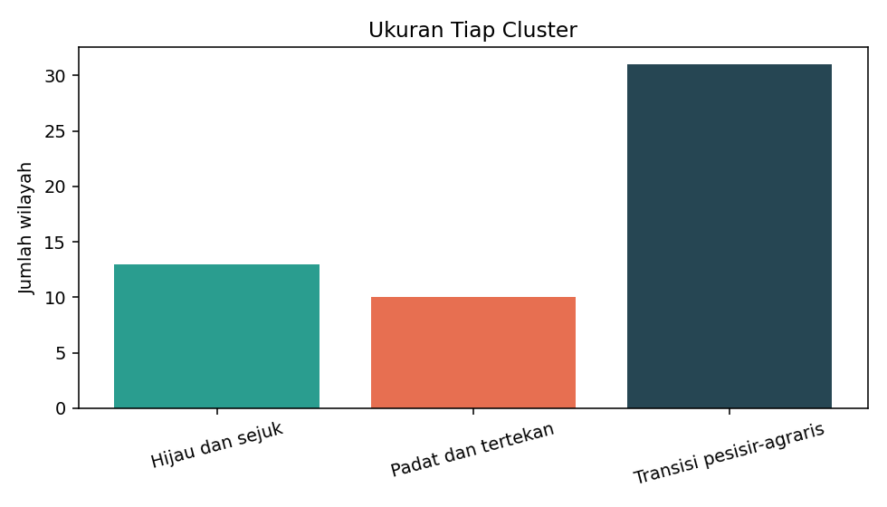

<div align="center">

# 🌿 EcoCluster

### Pengelompokan Wilayah Berdasarkan Indikator Lingkungan dengan k-Means

*Studi kasus Machine Learning (unsupervised learning) dari alur kerja ML end-to-end*


</div>

---

## 📑 Daftar Isi

1. [Latar Belakang](#-latar-belakang)
2. [Rumusan Masalah](#-rumusan-masalah)
3. [Tujuan](#-tujuan)
4. [Batasan Masalah](#-batasan-masalah)
5. [Dataset](#-dataset)
6. [Alur Kerja Machine Learning](#-alur-kerja-machine-learning)
7. [Struktur Proyek](#-struktur-proyek)
8. [Cara Menjalankan](#-cara-menjalankan)
9. [Hasil dan Pembahasan](#-hasil-dan-pembahasan)
10. [Overfitting dan Underfitting pada Clustering](#-overfitting-dan-underfitting-pada-clustering)
11. [Keterbatasan dan Pengembangan Lanjut](#-keterbatasan-dan-pengembangan-lanjut)

---

## 🌱 Latar Belakang

Pemerintah daerah dan peneliti sering menghadapi pertanyaan: *wilayah mana saja yang punya masalah lingkungan serupa?* Menjawabnya satu per satu untuk puluhan wilayah memakan waktu dan rentan subjektif.

**Machine Learning** membantu dengan mempelajari pola langsung dari data. Karena tidak ada label "kelompok yang benar" untuk setiap wilayah, pendekatan yang cocok adalah **unsupervised learning**, khususnya **clustering**. Proyek ini memakai algoritma **k-Means** untuk mengelompokkan wilayah berdasarkan tujuh indikator lingkungan.

Proyek ini mengikuti materi *Introduction to Machine Learning* (Sesi 4) dan menerapkan seluruh alur kerjanya:

```
Pengumpulan data → Pra-pemrosesan → Pemilihan fitur → Pembagian data
      → Pelatihan model → Evaluasi model → Prediksi
```

## ❓ Rumusan Masalah

1. Bagaimana mengelompokkan wilayah berdasarkan karakteristik lingkungannya secara objektif?
2. Berapa jumlah cluster yang paling sesuai untuk data tersebut?
3. Seberapa baik kualitas cluster dan apakah model stabil pada data yang belum pernah dilihat?
4. Bagaimana karakter tiap cluster dan bagaimana menempatkan wilayah baru ke dalam cluster?

## 🎯 Tujuan

- Menerapkan alur kerja ML lengkap pada kasus nyata berbasis data lingkungan.
- Menentukan jumlah cluster optimal dengan **Elbow**, **Silhouette Score**, dan **Davies-Bouldin Index**.
- Mengevaluasi kestabilan model dengan membandingkan **data latih** dan **data uji**.
- Menginterpretasi dan memvisualisasikan hasil cluster.

## 🚧 Batasan Masalah

| No | Batasan |
|----|---------|
| 1 | Algoritma yang digunakan hanya **k-Means** (tanpa DBSCAN, hierarchical, dan sebagainya). |
| 2 | Data berupa **72 wilayah sintetis** (fiktif) dengan 7 indikator lingkungan, dibuat agar proyek dapat dijalankan tanpa akses data resmi. |
| 3 | Setiap wilayah dianggap satu titik data pada satu periode waktu (**tidak ada dimensi waktu/tren**). |
| 4 | Tidak memakai data spasial (koordinat atau peta); kedekatan geografis **tidak** dipertimbangkan. |
| 5 | Rentang jumlah cluster yang diuji: **k = 2 sampai 8**. |
| 6 | Evaluasi memakai metrik internal (Silhouette dan Davies-Bouldin) karena tidak ada label asli. |
| 7 | Hasil bersifat ilustrasi metodologi, **bukan rekomendasi kebijakan**. |

## 📊 Dataset

File: [`data/indikator_lingkungan.csv`](data/indikator_lingkungan.csv)

Data dibangkitkan oleh `src/data_generator.py` dengan *random seed* tetap (42) dari empat tipe wilayah tersembunyi (pesisir, perkotaan, pegunungan, pertanian). Tipe ini **tidak** disertakan sebagai kolom, sehingga model harus menemukan polanya sendiri. Sekitar 4% nilai `indeks_air` sengaja dikosongkan untuk melatih tahap pra-pemrosesan.

| Kolom | Satuan | Keterangan |
|-------|--------|------------|
| `wilayah` | teks | Nama wilayah (fiktif) |
| `indeks_udara` | 0-100 | Kualitas udara, semakin tinggi semakin baik |
| `tutupan_hijau_pct` | % | Persentase tutupan lahan hijau |
| `curah_hujan_mm` | mm/tahun | Curah hujan tahunan |
| `suhu_rata_c` | °C | Suhu rata-rata |
| `kepadatan_jiwa_km2` | jiwa/km² | Kepadatan penduduk |
| `sampah_kg_per_jiwa` | kg/jiwa/hari | Timbulan sampah per kapita |
| `indeks_air` | 0-100 | Kualitas air, semakin tinggi semakin baik |

> ⚠️ **Catatan:** Untuk skripsi/penelitian nyata, ganti dengan data resmi (misalnya BPS, KLHK, BMKG) dan tentukan fitur berdasarkan literatur serta ketersediaan data.

## 🔄 Alur Kerja Machine Learning

| Tahap | Implementasi di proyek ini |
|-------|----------------------------|
| **1. Pengumpulan data** | Memuat CSV dan memeriksa tipe data, nilai kosong, serta nilai unik. |
| **2. Pra-pemrosesan** | Menghapus duplikat wilayah dan mengisi nilai kosong dengan **median** (tahan terhadap outlier). |
| **3. Pemilihan fitur** | Membuang fitur yang berkorelasi sangat tinggi (**> 0,9**) agar informasi yang sama tidak dihitung dua kali. Hasilnya `suhu_rata_c` dibuang karena berkorelasi 0,91 dengan `tutupan_hijau_pct`. |
| **4. Pembagian data** | 75% data latih (54 wilayah) dan 25% data uji (18 wilayah). Scaler hanya dipelajari dari data latih untuk mencegah *data leakage*. |
| **5. Pelatihan** | k-Means dicoba untuk k = 2..8; k dipilih berdasarkan Silhouette tertinggi. |
| **6. Evaluasi** | Silhouette dan Davies-Bouldin pada data latih dan uji, plus profil tiap cluster. |
| **7. Prediksi** | Menempatkan wilayah baru ke cluster terdekat. |

**Mengapa standardisasi?** k-Means memakai jarak Euclidean. Tanpa standardisasi, `curah_hujan_mm` (ribuan) akan mendominasi `indeks_udara` (puluhan) hanya karena skalanya.

## 🗂️ Struktur Proyek

```
ecocluster/
├── data/
│   └── indikator_lingkungan.csv     # dataset sintetis
├── src/
│   ├── config.py                    # konstanta dan daftar fitur
│   ├── data_generator.py            # pembangkit data sintetis
│   ├── preprocessing.py             # pembersihan, seleksi fitur, split, scaling
│   ├── clustering.py                # pencarian k dan pelatihan k-Means
│   ├── evaluation.py                # metrik, profil, dan penamaan cluster
│   └── visualization.py             # semua grafik
├── outputs/                         # hasil (grafik dan CSV)
├── main.py                          # menjalankan seluruh alur
├── requirements.txt
└── README.md
```

## ▶️ Cara Menjalankan

Prasyarat: **Python 3.10+**.

```bash
python -m venv .venv
source .venv/bin/activate        # Windows: .venv\Scripts\activate
pip install -r requirements.txt
python main.py
```

Semua grafik dan tabel hasil akan muncul di folder `outputs/`.

## 📈 Hasil dan Pembahasan

### 1. Penentuan jumlah cluster

| k | Inertia | Silhouette | Davies-Bouldin |
|---|--------:|-----------:|---------------:|
| 2 | 149,77 | 0,5471 | 0,5721 |
| **3** | **60,02** | **0,5562** | **0,5752** |
| 4 | 45,92 | 0,4154 | 0,8751 |
| 5 | 39,85 | 0,3958 | 1,0082 |
| 6 | 36,74 | 0,3223 | 1,2269 |
| 7 | 33,38 | 0,3571 | 0,9664 |
| 8 | 32,47 | 0,2533 | 1,1105 |

Penurunan inertia paling tajam terjadi dari k=2 ke k=3 (titik siku), dan Silhouette tertinggi juga ada di **k = 3**. Jadi **k = 3** dipilih.



> 💡 Data dibangkitkan dari 4 tipe wilayah, tetapi model menemukan 3 cluster. Alasannya, tipe *pesisir* dan *pertanian* punya karakter yang tumpang tindih sehingga digabung menjadi satu cluster transisi. Ini contoh bahwa jumlah cluster yang "benar" menurut metrik tidak selalu sama dengan jumlah kelompok yang kita bayangkan.

### 2. Evaluasi data latih vs data uji

| Data | Jumlah | Silhouette | Davies-Bouldin |
|------|-------:|-----------:|---------------:|
| Latih | 54 | 0,5562 | 0,5752 |
| Uji | 18 | 0,5544 | 0,3755 |

Selisih Silhouette hanya **0,0018**, sehingga model **stabil** dan tidak menunjukkan tanda overfitting.

### 3. Profil cluster

| Cluster | Udara | Hijau (%) | Hujan (mm) | Kepadatan | Sampah | Air | Jumlah |
|---------|------:|----------:|-----------:|----------:|-------:|----:|-------:|
| 🌲 Hijau dan sejuk | 91,74 | 73,55 | 3180,54 | 194 | 0,21 | 84,72 | 13 |
| 🏙️ Padat dan tertekan | 51,08 | 12,10 | 1977,63 | 5240 | 0,92 | 44,93 | 10 |
| 🌾 Transisi pesisir-agraris | 79,14 | 34,37 | 2420,24 | 743 | 0,51 | 62,22 | 31 |



### 4. Sebaran dan ukuran cluster





### 5. Prediksi wilayah baru

| Wilayah | Cluster | Karakter |
|---------|--------:|----------|
| Contoh-A (hijau tinggi, padat rendah) | 0 | Hijau dan sejuk |
| Contoh-B (padat tinggi, hijau rendah) | 1 | Padat dan tertekan |

Hasil lengkap tiap wilayah ada di `outputs/hasil_clustering.csv`.

## ⚖️ Overfitting dan Underfitting pada Clustering

Konsep dari materi tetap relevan pada clustering:

- **Overfitting**: k terlalu besar. Inertia terus turun, tetapi cluster menjadi terlalu kecil dan tidak bermakna (terlihat dari Silhouette yang anjlok pada k=8).
- **Underfitting**: k terlalu kecil. Wilayah yang sebenarnya berbeda dipaksa masuk satu kelompok.
- **Pengecekan**: karena itu data dibagi menjadi latih dan uji, lalu kualitas cluster dibandingkan pada keduanya.

## 🔭 Keterbatasan dan Pengembangan Lanjut

- Data sintetis, bukan kondisi nyata.
- k-Means mengasumsikan cluster berbentuk bulat dan berukuran mirip, serta sensitif terhadap outlier.
- Pengembangan yang bisa dilakukan:
  - memakai data resmi dan menambah dimensi waktu;
  - membandingkan dengan **Gaussian Mixture**, **DBSCAN**, atau **hierarchical clustering**;
  - memetakan hasil ke peta wilayah (GeoPandas);
  - menguji kestabilan cluster dengan bootstrap.

---

<div align="center">

Dibuat sebagai studi kasus pembelajaran *Introduction to Machine Learning*.

</div>
